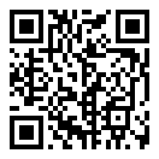
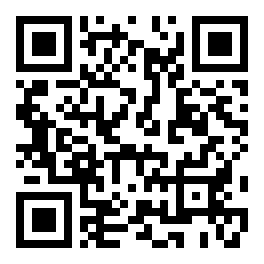

# Donasi / Donate

Terima kasih sudah mendukung proyek ini! Donasi kripto bisa dikirim ke alamat di bawah.
Thank you for supporting this project! Crypto donations can be sent to the addresses below.

> ⚠️ **Penting / Important:** Periksa **jaringan (network)** sebelum mengirim.
> Mengirim ke jaringan yang salah dapat menyebabkan dana **hilang permanen**.
> Always double-check the **network** before sending. Wrong-network transfers may be **lost forever**.

---

## Bitcoin (BTC)

**Jaringan / Network:** Bitcoin (mainnet) saja / only

```
1455F5BFc41XKc1Tjg8himciuiZXtHdrsz
```



---

## Ethereum, BNB, USDT (alamat EVM yang sama / same EVM address)

```
0x411bd0C7a9A18d5A66B79F8C8c9D2b214D4A8214
```



| Koin / Coin | Jaringan yang diterima / Accepted network |
|---|---|
| ETH  | Ethereum (ERC-20) |
| BNB  | BNB Smart Chain (BEP-20) |
| USDT | Ethereum (ERC-20) atau / or BNB Smart Chain (BEP-20) |

❌ **Jangan kirim / Do not send** via TRON (TRC-20), Solana, atau jaringan lain yang tidak tercantum di atas / or any network not listed above.

---

### Verifikasi alamat / Verify the address

Alamat resmi hanya yang tercantum di file ini pada repositori resmi. Waspadai repositori tiruan.
The only official addresses are those in this file on the official repository. Beware of copycat repos.
