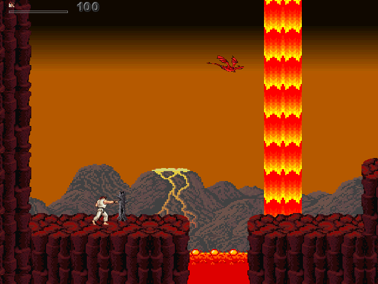
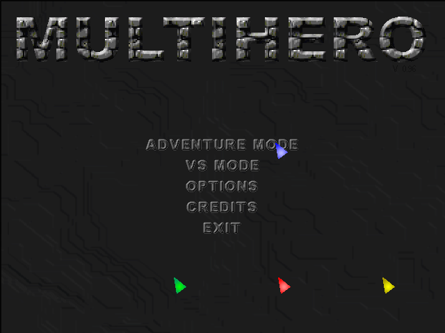
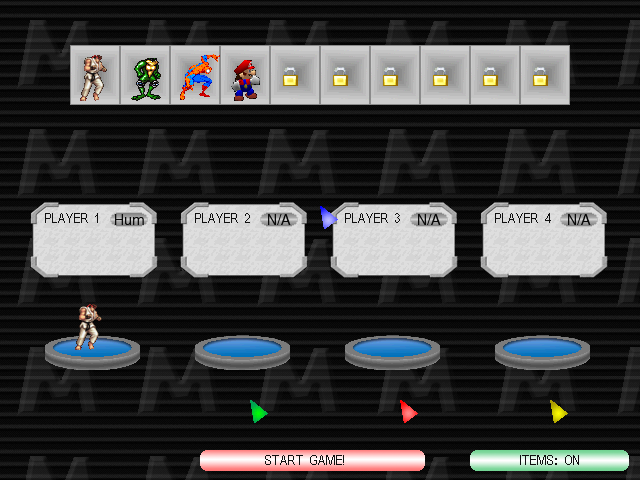
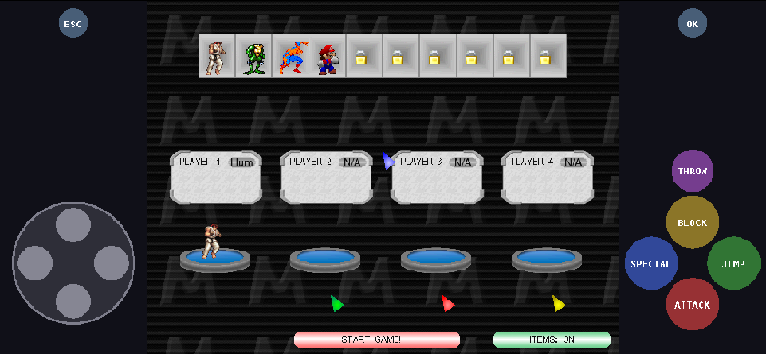

# MultiHero – Web Port

Play **MultiHero 0.96**, the 2D multiplayer platform fighting game by **mhman**, in a web browser.

<p align="center">
  <a href="https://richardyusan.github.io/multihero-web/"><b>▶&nbsp;&nbsp;PLAY NOW IN YOUR BROWSER</b></a><br>
  <sub>Free, no install · keyboard, mouse, gamepad or touch · about 12 MB download</sub>
</p>

The original Blitz3D / Blitz BASIC source is kept **unchanged**. A small transpiler turns it into C++,
a tiny 2D runtime replaces Blitz, and Emscripten compiles everything to **WebAssembly**. No game
engine, no plugins: one HTML page, one `.wasm` file and the game data.

This is the browser version of the [MultiHero Android port](https://github.com/richardyusan/multihero-android);
both share the same transpiler and runtime.

[](https://richardyusan.github.io/multihero-web/)

| Menu | Character select |
|---|---|
|  |  |
| **In game** | **Phone (touch controls)** |
|  |  |

## Features

- Runs in modern browsers on desktop and mobile (tested in Chromium); nothing to install.
- Original speed: game logic at **54 fps** like the PC game, display capped at 60 fps.
- **Keyboard** (uses your `keys.cfg`, Options → Controls works), **mouse** for the menus,
  **gamepads** (Gamepad API) and **on-screen touch controls** on phones and tablets.
- Sound through Web Audio (24 channels, 44.1 kHz).
- Settings (`game.cfg`, `keys.cfg`) are saved in the browser (IndexedDB).
- Full-screen button; phones go full screen in landscape when you press Play.
- About 2 MB of code + 11 MB of game data (LZ4-compressed, 25 MB unpacked).

## Play online

**<https://richardyusan.github.io/multihero-web/>** — click **▶ Play**. The game is served by GitHub
Pages from the [`docs/`](docs/) folder of this repository (`index.html`, `multihero.js`,
`multihero.wasm`, `multihero.data`).

To play offline, download this repository (**Code → Download ZIP**), then open the `docs` folder
with a local web server (see [Play](#play) below).

## Game data

The original game files are not in this repository as loose files. The only copy is packed inside
`docs/multihero.data` for the online version. Many characters belong to third parties
(see [NOTICE.md](NOTICE.md)).

To **build** the game yourself you need the original **MultiHero 0.96** folder (`gfx/`, `sounds/`,
`Maps/`, `game.cfg`, `keys.cfg`, `maps.dat`). Copy it into `game/` or pass its path to the build
script — see [game/README.md](game/README.md).

## Build

Requirements: **Linux or WSL** (Windows Subsystem for Linux), **Python 3** with **Pillow**, git and
the **Emscripten SDK**.

```bash
# 1. Emscripten (once)
git clone https://github.com/emscripten-core/emsdk.git ~/emsdk
cd ~/emsdk && ./emsdk install latest && ./emsdk activate latest

# 2. Python image library (once)
pip install pillow

# 3. Build
git clone https://github.com/richardyusan/multihero-web.git
cd multihero-web
./build_web.sh /path/to/MultiHero096       # on WSL, drive E: is /mnt/e/...
```

The build takes about 1½ minutes and writes everything to `build/web/`:

```
build/web/
├── index.html        page, input, sound, saving
├── multihero.js      loader
├── multihero.wasm    the game (WebAssembly)
├── multihero.data    gfx, sounds, maps
├── icon.png
└── play_web.bat      Windows helper to play locally
```

Build options (environment variables):

| Variable | Effect |
|---|---|
| `CODE_ONLY=1` | compile the code without game data (check that it builds; the page won't start) |
| `ASYNC=jspi` | use JSPI instead of ASYNCIFY: faster build and code, but **Chrome/Edge 137+ only** |
| `DEBUG=1` | unoptimised build with runtime checks |
| `PAGES=1` | also copy the playable files into `docs/` (updates the online version after a push) |
| `EMSDK=/path` | where emsdk is installed (default `~/emsdk`) |

## Play

The page has to be loaded from a web server; opening `index.html` by double-clicking it does not work.

- **Windows:** double-click `build/web/play_web.bat` (needs Python). Your browser opens
  `http://localhost:8080`. For the ready-made copy in `docs/`, copy `web/play_web.bat` into `docs/` first.
- **Linux / WSL / macOS:**

  ```bash
  cd build/web && python3 -m http.server 8080
  ```

  then open <http://localhost:8080>.

Click **▶ Play** (browsers only allow sound after a click).

### Put it online

This repository already hosts the game with **GitHub Pages**:

1. On GitHub: **Settings → Pages → Build and deployment → Source: Deploy from a branch**,
   branch **`main`**, folder **`/docs`** → **Save**.
2. After a minute the game is live at `https://<your-user>.github.io/<repo-name>/`.
3. To publish a new version: `PAGES=1 ./build_web.sh /path/to/MultiHero096`, then commit and push
   the changed files in `docs/`.

Any other static host works too (Netlify, Cloudflare Pages, itch.io as an HTML5 game): upload the
files from `build/web/` or `docs/`. No special server settings are needed.

## Controls

| Keyboard (player 1 default) | Gamepad | Touch | Action |
|---|---|---|---|
| W A S D | D-pad / left stick | D-pad | move, menus |
| N | A | ATTACK | attack |
| M | B | JUMP | jump |
| H | X | SPECIAL | special |
| Space | Y, L2 / R2 | BLOCK | block |
| J | L1 / R1 | THROW | throw / pick up |
| Esc | Select / Back | ESC | in-game menu |
| Enter | Start | OK | confirm |
| Mouse | – | tap the game picture | click in menus |

Keys can be changed in **Options → Controls**, just like in the PC game. The touch buttons always
follow player 1's keys, and they hide while you use a keyboard or gamepad.

## How it works

```
src/*.bb ──(tools/bb2cpp.py)──▶ mh.cpp ─┐
              runtime/bbrt.cpp  ────────┤  em++ (Emscripten)
           runtime/mh_glue.cpp  ────────┼──────────────────▶ multihero.wasm + multihero.js
          runtime/web_main.cpp  ────────┘                     + web/shell.html → index.html
game data ──(tools/prep_assets.py)──────────────────────────▶ multihero.data
```

- **`tools/bb2cpp.py`** – Blitz BASIC → C++ transpiler that copies Blitz's rules (case-insensitive
  names, type suffixes, integer division, `Goto`, `Select`, …).
- **`runtime/bbrt.cpp`** – portable Blitz 2D runtime: 640×480 software renderer with colour-key
  masks, BMP loader, WAV + 24-channel mixer, case-insensitive files, timers, input, touch controls.
- **`runtime/web_main.cpp`** – browser backend. The game is a normal blocking Blitz loop, so the
  build uses **ASYNCIFY**: every wait (`WaitTimer`, `Flip`, `Delay`, input polling) briefly hands
  control back to the browser, which paints the frame, delivers input and plays sound, then the
  game continues.
- **`web/shell.html`** – the page: canvas scaling (sharp pixels), keyboard/mouse/touch/gamepad,
  Web Audio, saving to IndexedDB, loading screen.

More detail: [docs/HOW_IT_WORKS.md](docs/HOW_IT_WORKS.md) (transpiler and runtime) and
[docs/WEB.md](docs/WEB.md) (browser backend).

## Repository layout

| Path | Contents |
|---|---|
| `src/` | Original MultiHero 0.96 Blitz source by mhman (unchanged) |
| `tools/` | `bb2cpp.py` transpiler, `prep_assets.py` asset preparation, font generator |
| `runtime/` | Blitz 2D runtime, game glue, web backend, headless Linux test backend |
| `web/` | Page template (`shell.html`), icon, `play_web.bat` |
| `scripts/` | `test_linux.sh` – headless build + smoke test (no browser needed) |
| `docs/` | The playable build for GitHub Pages (`index.html`, `.js`, `.wasm`, `.data`), docs, screenshots |
| `game/` | Put the original game data here to build (not included) |
| `build_web.sh` | Builds the web version |

## Limitations

- The level editor (`Editor.bb`) is not ported.
- A gamepad controls player 1 only. Other human players can share the keyboard with their own keys
  from Options → Controls. There is no online play.
- On iPhone/iPad, full screen and screen-rotation lock depend on Safari's support.
- Tested in Chromium (desktop and phone-sized touch layout). Please report problems in other
  browsers in the Issues.

## Credits

- **MultiHero** and its source code: **mhman**, the creator of MultiHero. All credit for the game goes to him.
- Characters, sprites and sounds: their respective owners (see [NOTICE.md](NOTICE.md)).
- Web and Android port: transpiler, runtime and backends in this repository.

## License

The porting code (`tools/`, `runtime/`, `web/`, `scripts/`, `build_web.sh`, `.github/`, `docs/`) is
released under the [MIT License](LICENSE). The original game source in `src/` and the game data
remain under their owners' terms — see [NOTICE.md](NOTICE.md).

## Donation

To support this porting project, you can donate:

| Koin | Jaringan | Alamat |
|---|---|---|
| BTC | Bitcoin | `1455F5BFc41XKc1Tjg8himciuiZXtHdrsz` |
| ETH | Ethereum (ERC-20) | `0x411bd0C7a9A18d5A66B79F8C8c9D2b214D4A8214` |
| BNB | BNB Smart Chain (BEP-20) | `0x411bd0C7a9A18d5A66B79F8C8c9D2b214D4A8214` |
| USDT | ERC-20 / BEP-20 | `0x411bd0C7a9A18d5A66B79F8C8c9D2b214D4A8214` |

Details and QR code: [DONATE.md](DONATE.md)
